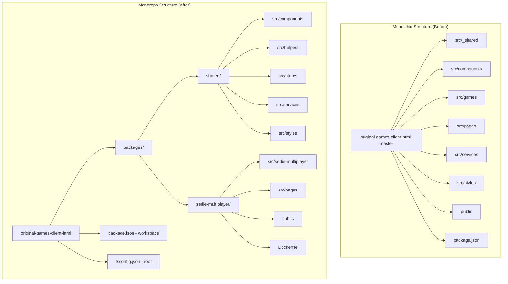
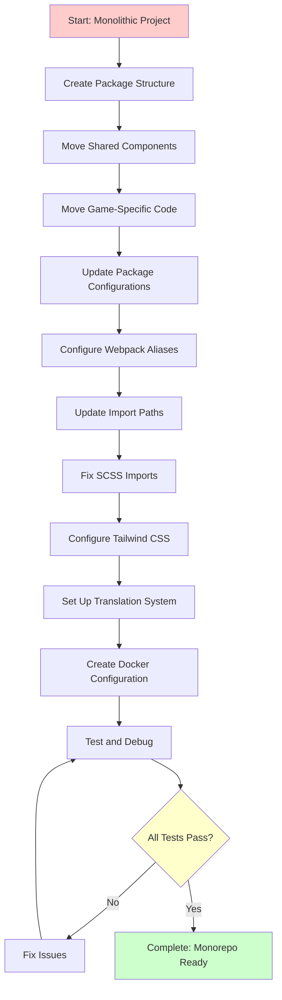
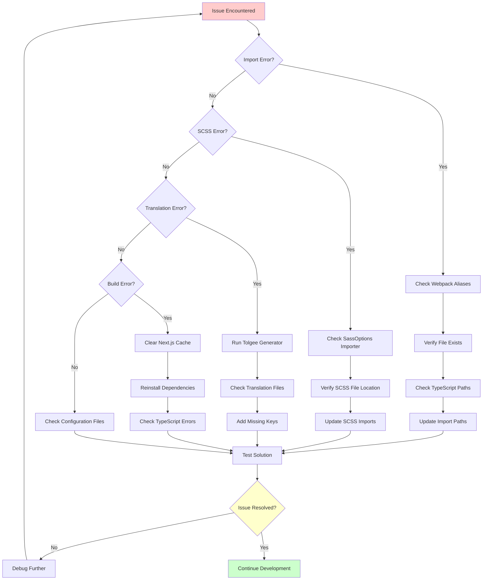

# Monorepo Restructure Documentation

## Overview

This document details the complete process of restructuring the `original-games-client-html` project from a monolithic structure to a monorepo architecture. The restructuring enables better code organization, reusability, and maintainability by separating shared components from game-specific implementations.

## Table of Contents

1. [Project Structure Comparison](#project-structure-comparison)
2. [Restructuring Process](#restructuring-process)
3. [Key Changes Made](#key-changes-made)
4. [Configuration Updates](#configuration-updates)
5. [Import Path Migration](#import-path-migration)
6. [Docker Integration](#docker-integration)
7. [Translation System Integration](#translation-system-integration)
8. [Troubleshooting Guide](#troubleshooting-guide)
9. [Development Workflow](#development-workflow)

## Project Structure Comparison

### Before (Monolithic Structure)

```
original-games-client-html-master/
├── src/
│   ├── _shared/           # Shared utilities and components
│   ├── components/        # Game components
│   ├── games/            # Game-specific implementations
│   ├── pages/            # Next.js pages
│   ├── services/         # API services
│   └── styles/           # Global styles
├── public/               # Static assets
├── configs/              # Configuration files
└── package.json          # Single package configuration
```

### After (Monorepo Structure)

```
original-games-client-html/
├── packages/
│   ├── shared/           # Shared package (@shared)
│   │   ├── src/
│   │   │   ├── components/    # Reusable components
│   │   │   ├── helpers/       # Utility functions
│   │   │   ├── stores/        # State management
│   │   │   ├── services/      # API services
│   │   │   └── styles/        # Shared styles
│   │   └── package.json
│   └── sedie-multiplayer/ # Game package (@sedie-multiplayer)
│       ├── src/
│       │   ├── sedie-multiplayer/  # Game logic
│       │   ├── components/         # Game-specific components
│       │   ├── pages/              # Next.js pages
│       │   └── styles/             # Game-specific styles
│       ├── public/                 # Game assets
│       ├── Dockerfile              # Container configuration
│       └── package.json
├── package.json          # Root workspace configuration
└── tsconfig.json         # Root TypeScript configuration
```

### Architecture Diagram



### Import Flow Diagram

```mermaid
graph LR
    subgraph "Game Package"
        A[sedie-multiplayer/src/page.tsx]
        B[sedie-multiplayer/src/components/]
        C[sedie-multiplayer/src/styles/]
    end

    subgraph "Shared Package"
        D[shared/src/components/]
        E[shared/src/helpers/]
        F[shared/src/stores/]
        G[shared/src/styles/]
    end

    A -->|@shared/components/game-base/type| D
    A -->|@shared/helpers/socket-connection| E
    A -->|@shared/stores/game-store| F
    B -->|@shared/components/game-components/| D
    C -->|@shared/styles/components/| G
```

## Restructuring Process

### Process Flow Diagram



### Phase 1: Package Creation and Structure Setup

1. **Created Package Structure**

    - Created `packages/shared/` for reusable components
    - Created `packages/sedie-multiplayer/` for game-specific code
    - Set up individual `package.json` files for each package

2. **Moved Shared Components**

    - Moved `src/_shared/` → `packages/shared/src/`
    - Moved `src/components/` → `packages/shared/src/components/`
    - Moved `src/services/` → `packages/shared/src/services/`
    - Moved `src/styles/` → `packages/shared/src/styles/`

3. **Moved Game-Specific Code**
    - Moved `src/games/sedie-multiplayer/` → `packages/sedie-multiplayer/src/sedie-multiplayer/`
    - Moved `src/pages/` → `packages/sedie-multiplayer/src/pages/`
    - Moved game-specific assets to `packages/sedie-multiplayer/public/`

### Phase 2: Configuration Updates

#### Root Package.json Changes

```json
{
    "workspaces": ["packages/*"],
    "scripts": {
        "generate-tolgee-data": "npx ts-node --project tsconfig.node.json ./packages/shared/src/tolgee-generator.ts",
        "dev:sedie-multiplayer": "npm run generate-tolgee-data && cross-env NEXT_PUBLIC_DEFAULT_GAME_ID=148 HOST=sedie.local PORT=3001 next dev -p 3001",
        "build:shared": "npm run -w @shared/merged build",
        "build:games": "npm run -w @games/sedie-multiplayer build",
        "build:all": "npm run build:shared && npm run build:games && npm run build"
    }
}
```

#### Package-Specific Configurations

**Shared Package (`packages/shared/package.json`)**

```json
{
    "name": "@shared/merged",
    "main": "dist/index.js",
    "types": "dist/index.d.ts",
    "scripts": {
        "build": "tsc",
        "dev": "tsc --watch"
    }
}
```

**Sedie-Multiplayer Package (`packages/sedie-multiplayer/package.json`)**

```json
{
    "name": "@games/sedie-multiplayer",
    "scripts": {
        "generate-tolgee-data": "npx ts-node --project tsconfig.node.json ../shared/src/tolgee-generator.ts",
        "dev:standalone": "npm run generate-tolgee-data && cross-env NEXT_PUBLIC_DEFAULT_GAME_ID=148 FAST_REFRESH=false next dev -p 3001",
        "build:standalone": "npm run generate-tolgee-data && next build",
        "start:standalone": "cross-env NEXT_PUBLIC_DEFAULT_GAME_ID=148 next start -p 3001"
    }
}
```

### Phase 3: Import Path Migration

#### Webpack Alias Configuration

Updated `next.config.js` to include package aliases:

```javascript
const path = require("path");

module.exports = {
    webpack: (config) => {
        config.resolve.alias = {
            ...config.resolve.alias,
            "@shared": path.resolve(__dirname, "../shared/src"),
            "@sedie-multiplayer": path.resolve(__dirname, "src"),
        };
        return config;
    },
    sassOptions: {
        includePaths: [path.join(__dirname, "../shared/src/styles")],
        importer: (url) => {
            if (url.startsWith("@shared/")) {
                return {
                    file: path.resolve(__dirname, "../shared/src", url.replace("@shared/", "")),
                };
            }
            return null;
        },
    },
};
```

#### Import Path Updates

-   **Before**: `import { Component } from '../../../components/game-base/type'`
-   **After**: `import { Component } from '@shared/components/game-base/type'`

### Phase 4: SCSS Import Resolution

#### SCSS Alias Configuration

```javascript
sassOptions: {
  includePaths: [path.join(__dirname, '../shared/src/styles')],
  importer: (url) => {
    if (url.startsWith('@shared/')) {
      return {
        file: path.resolve(__dirname, '../shared/src', url.replace('@shared/', ''))
      };
    }
    return null;
  }
}
```

#### SCSS Import Updates

-   **Before**: `@import "../../../styles/components/animations/common";`
-   **After**: `@import "@shared/styles/components/animations/common";`

### Phase 5: Tailwind CSS Configuration

Updated `tailwind.config.js` to include shared package files:

```javascript
module.exports = {
    content: ["./src/**/*.{js,ts,jsx,tsx,mdx}", "../shared/src/**/*.{js,ts,jsx,tsx,mdx}"],
    safelist: ["bg-red-500", "bg-white-500", "text-red-500", "text-white-500"],
};
```

## Key Changes Made

### 1. File Structure Reorganization

#### Shared Package Structure

```
packages/shared/src/
├── components/
│   ├── game-base/        # Base game components
│   ├── game-components/  # Reusable game components
│   └── page-components/  # Page-level components
├── helpers/              # Utility functions
├── stores/               # State management (Zustand)
├── services/             # API services
├── styles/               # Shared SCSS files
├── react-contexts/       # React contexts
├── react-hooks/          # Custom hooks
└── utils/                # Utility functions
```

#### Game Package Structure

```
packages/sedie-multiplayer/src/
├── sedie-multiplayer/    # Main game logic
├── components/           # Game-specific components
├── pages/                # Next.js pages
├── styles/               # Game-specific styles
├── games/                # Game routing
└── public/               # Game assets
```

### 2. Import Path Migration Scripts

Created automated scripts to fix import paths:

#### `fix-imports.js` - Game Package Imports

```javascript
const fs = require("fs");
const path = require("path");

// Fixes relative imports within sedie-multiplayer package
const patterns = [
    { from: /from ['"]\.\.\/sedie-multiplayer-constants['"]/g, to: "from '../sedie-multiplayer-constants'" },
    { from: /from ['"]\.\.\/components\/game-components\//g, to: "from '@shared/components/game-components/" },
    // ... more patterns
];
```

#### `fix-shared-imports.js` - Shared Package Imports

```javascript
// Fixes malformed @shared imports
const patterns = [
    { from: /from ['"]@shared\/stores\/game-store\/game-store";/g, to: "from '@shared/stores/game-store/game-store';" },
    { from: /from ['"]@shared\/utils\/merge-tailwind-util"/g, to: "from '@shared/utils/merge-tailwind-util';" },
    // ... more patterns
];
```

### 3. Missing Index Files Creation

Created missing `index.ts` files for proper module exports:

```typescript
// packages/shared/src/stores/index.ts
export * from "./bet-history-store";
export * from "./betting-store";
export * from "./game-store";
// ... other stores

// packages/shared/src/utils/index.ts
export * from "./merge-tailwind-util";
export * from "./modal-stack-manager";
export * from "./iframe-messages";
```

### 4. Translation System Integration

#### Tolgee Generator Integration

-   Moved `tolgee-generator.ts` to `packages/shared/src/`
-   Updated package scripts to run tolgee generation before build/dev
-   Created `tsconfig.node.json` for ts-node compatibility

#### Translation File Structure

```
packages/sedie-multiplayer/public/i18n/
├── Common/               # Common translations
├── SabaNumber/          # Number game translations
└── SeDie/               # SeDie game translations
    ├── en.json
    ├── id.json
    ├── ja.json
    ├── th.json
    ├── vi.json
    ├── zh_cn.json
    └── zh_tw.json
```

## Configuration Updates

### TypeScript Configuration

#### Root `tsconfig.json`

```json
{
    "compilerOptions": {
        "baseUrl": ".",
        "paths": {
            "@shared/*": ["packages/shared/src/*"],
            "@sedie-multiplayer/*": ["packages/sedie-multiplayer/src/*"]
        }
    },
    "references": [{ "path": "./packages/shared" }, { "path": "./packages/sedie-multiplayer" }]
}
```

#### Package-Specific `tsconfig.json`

```json
{
    "extends": "../../tsconfig.json",
    "compilerOptions": {
        "outDir": "./dist",
        "rootDir": "./src"
    },
    "include": ["src/**/*"],
    "exclude": ["node_modules", "dist"]
}
```

### Next.js Configuration

#### Game Package `next.config.js`

```javascript
const path = require("path");

module.exports = {
    webpack: (config) => {
        config.resolve.alias = {
            ...config.resolve.alias,
            "@shared": path.resolve(__dirname, "../shared/src"),
            "@sedie-multiplayer": path.resolve(__dirname, "src"),
        };
        return config;
    },
    sassOptions: {
        includePaths: [path.join(__dirname, "../shared/src/styles")],
        importer: (url) => {
            if (url.startsWith("@shared/")) {
                return {
                    file: path.resolve(__dirname, "../shared/src", url.replace("@shared/", "")),
                };
            }
            return null;
        },
    },
};
```

## Docker Integration

### Dockerfile for Game Package

```dockerfile
FROM hub.lumigame.com/base/node:24-alpine-25h2 AS base

FROM base AS deps
WORKDIR /app
ENV YARN_CACHE_FOLDER=/root/.yarn

# Copy package files
COPY package.json yarn.lock ./
COPY packages/shared/package.json packages/shared/package.json
COPY packages/sedie-multiplayer/package.json packages/sedie-multiplayer/package.json
RUN --mount=type=cache,target=$YARN_CACHE_FOLDER \
     yarn install --frozen-lockfile --verbose

FROM base AS builder
WORKDIR /app

# Copy dependencies and source code
COPY --from=deps /app/node_modules ./node_modules
COPY packages/sedie-multiplayer/ ./packages/sedie-multiplayer/
COPY packages/shared/ ./packages/shared/

# Build the application
WORKDIR /app/packages/sedie-multiplayer
RUN yarn generate-tolgee-data
RUN yarn build:standalone

FROM base AS runner
WORKDIR /app
ENV NODE_ENV=production

# Copy built application
COPY --from=builder --chown=nextjs:nodejs /app/node_modules ./node_modules
COPY --from=builder --chown=nextjs:nodejs /app/packages/sedie-multiplayer/.next ./.next
COPY --from=builder --chown=nextjs:nodejs /app/packages/sedie-multiplayer/public ./public

USER nextjs
EXPOSE 3001
ENV PORT=3001
CMD ["sh", "-c", "NEXT_PUBLIC_DEFAULT_GAME_ID=148 ./node_modules/.bin/next start -p 3001"]
```

## Translation System Integration

### Tolgee Generator Setup

```typescript
// packages/shared/src/tolgee-generator.ts
const { DevTools, Tolgee } = require("@tolgee/react");
const fs = require("fs");
const path = require("path");
const gameSettings = require("../../sedie-multiplayer/game-settings.json");

const locales = { en: "en", vi: "vi", th: "th", id: "id", zh_cn: "zh_cn", zh_tw: "zh_tw", ja: "ja" };
const namespaces = ["SabaNumber", "Common", "SeDie"];

const tg = Tolgee()
    .use(DevTools())
    .init({
        defaultLanguage: "en",
        fallbackLanguage: "en",
        availableLanguages: Object.values(locales),
        apiKey: "tgpak_gvpw45brha2xg3btoztxeytunvudc5dbn5twqodtonztc",
        apiUrl: "https://tolgee.sabagame.com/",
        projectId: "5",
        defaultNs: "SabaNumber",
        ns: namespaces,
    });

tg.on("initialLoad", async () => {
    // Generate translation files for all languages and namespaces
    Object.values(locales).forEach(async (languageId) => {
        await tg.changeLanguage(languageId);
        // Write translation files to public/i18n/
    });
});
```

### Package Script Integration

```json
{
    "scripts": {
        "generate-tolgee-data": "npx ts-node --project tsconfig.node.json ../shared/src/tolgee-generator.ts",
        "dev:standalone": "npm run generate-tolgee-data && cross-env NEXT_PUBLIC_DEFAULT_GAME_ID=148 FAST_REFRESH=false next dev -p 3001",
        "build:standalone": "npm run generate-tolgee-data && next build"
    }
}
```

## Troubleshooting Guide

### Troubleshooting Flow Diagram



### Common Issues and Solutions

#### 1. Import Resolution Errors

**Error**: `Cannot find module '@shared/components/game-base/type'`

**Solution**:

-   Verify webpack alias configuration in `next.config.js`
-   Check that the file exists in `packages/shared/src/components/game-base/type.ts`
-   Ensure TypeScript path mapping is correct

#### 2. SCSS Import Errors

**Error**: `Can't find stylesheet to import '@shared/styles/components/animations/common'`

**Solution**:

-   Verify sassOptions importer function in `next.config.js`
-   Check that the SCSS file exists in the correct location
-   Ensure the importer function handles the `@shared/` prefix correctly

#### 3. Missing Translation Keys

**Error**: `t("scoreboard_even")` returns undefined

**Solution**:

-   Run `npm run generate-tolgee-data` to update translation files
-   Manually add missing keys to translation JSON files
-   Verify Tolgee API connection and project configuration

#### 4. TypeScript Compilation Errors

**Error**: `Module '"@shared/helpers"' has no exported member 'createNotice'`

**Solution**:

-   Check function name in the source file
-   Verify export statements in `packages/shared/src/helpers/index.ts`
-   Ensure all required functions are properly exported

#### 5. Build Failures

**Error**: `npm run build:standalone` fails

**Solution**:

-   Clear Next.js cache: `rm -rf .next`
-   Clear node_modules and reinstall: `rm -rf node_modules && npm install`
-   Check for TypeScript errors: `npx tsc --noEmit`
-   Verify all import paths are correct

### Debugging Steps

1. **Check Package Structure**

    ```bash
    # Verify package structure
    ls -la packages/
    ls -la packages/shared/src/
    ls -la packages/sedie-multiplayer/src/
    ```

2. **Verify Import Paths**

    ```bash
    # Search for problematic imports
    grep -r "from.*\.\./\.\./\.\." packages/sedie-multiplayer/src/
    grep -r "from.*@shared" packages/sedie-multiplayer/src/
    ```

3. **Check Configuration Files**

    ```bash
    # Verify webpack aliases
    cat packages/sedie-multiplayer/next.config.js
    # Verify TypeScript paths
    cat packages/sedie-multiplayer/tsconfig.json
    ```

4. **Test Translation Generation**
    ```bash
    # Run tolgee generator manually
    cd packages/sedie-multiplayer
    npm run generate-tolgee-data
    ```

## Development Workflow

### Local Development

1. **Start Development Server**

    ```bash
    # From root directory
    npm run dev:sedie-multiplayer

    # Or from game package directory
    cd packages/sedie-multiplayer
    npm run dev:standalone
    ```

2. **Build for Production**

    ```bash
    # Build all packages
    npm run build:all

    # Build specific game
    cd packages/sedie-multiplayer
    npm run build:standalone
    ```

3. **Run Tests**

    ```bash
    # Run all tests
    npm test

    # Run specific package tests
    cd packages/sedie-multiplayer
    npm test
    ```

### Docker Development

1. **Build Docker Image**

    ```bash
    cd packages/sedie-multiplayer
    docker build -t sedie-multiplayer .
    ```

2. **Run Docker Container**
    ```bash
    docker run -p 3001:3001 sedie-multiplayer
    ```

### Adding New Games

1. **Create New Game Package**

    ```bash
    mkdir packages/new-game
    cd packages/new-game
    npm init -y
    ```

2. **Set Up Package Configuration**

    - Create `package.json` with game-specific dependencies
    - Create `next.config.js` with webpack aliases
    - Create `tsconfig.json` extending root configuration
    - Create `Dockerfile` for containerization

3. **Update Root Configuration**
    - Add new game to root `package.json` scripts
    - Update workspace configuration if needed
    - Add build scripts for new game

## Benefits of Monorepo Structure

### 1. Code Reusability

-   Shared components can be used across multiple games
-   Consistent UI/UX across all games
-   Centralized utility functions and helpers

### 2. Better Organization

-   Clear separation between shared and game-specific code
-   Easier to maintain and update shared components
-   Simplified dependency management

### 3. Scalability

-   Easy to add new games without duplicating shared code
-   Independent deployment of individual games
-   Better testing and CI/CD pipeline support

### 4. Development Experience

-   Faster development with shared component library
-   Consistent coding standards across packages
-   Better IDE support with proper TypeScript configuration

## Conclusion

The monorepo restructuring successfully transformed the monolithic `original-games-client-html` project into a scalable, maintainable architecture. The new structure enables:

-   **Modular Development**: Each game can be developed independently
-   **Code Sharing**: Common components and utilities are centralized
-   **Easy Maintenance**: Updates to shared components benefit all games
-   **Scalable Architecture**: New games can be added without restructuring existing code

The implementation includes comprehensive tooling for development, building, testing, and deployment, making it ready for production use and future expansion.

---

_This documentation was created as part of the monorepo restructuring process and should be updated as the project evolves._
